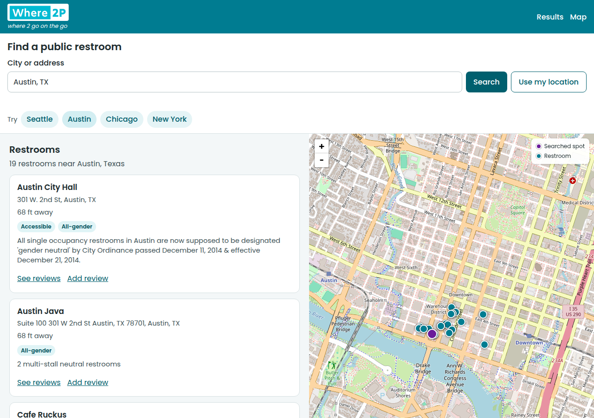

# Where2P

Where2P helps you find a public restroom while you are out. Search for a city or address, or use your current location. Matching places show up in a list and on a map, including accessible, all-gender, and changing-table details when the listing has them. You can read reviews and leave your own.



Live site: [https://halliecalhoun.github.io/where2p-app/](https://halliecalhoun.github.io/where2p-app/)

GitHub Pages publishes the `master` branch from the repository root. There is no build step for the website. The iOS app is a Capacitor project in `ios/` and is documented in [docs/APP_STORE.md](docs/APP_STORE.md). `npm run build:web` copies this site into `www/` for that app. It does not move the files Pages serves.

## Run it locally

From this folder, start any static file server:

```bash
python3 -m http.server 8080
```

Open [http://localhost:8080](http://localhost:8080). Search works right away. "Use my location" needs a browser that can share your location. `localhost` counts as a secure page, so that button works there too.

## Tech stack

- HTML, CSS, and JavaScript, with no framework and no build
- [Leaflet](https://leafletjs.com/) and [OpenStreetMap](https://www.openstreetmap.org/copyright) for the map
- [Refuge Restrooms](https://www.refugerestrooms.org/) for the restroom listings
- [Photon](https://photon.komoot.io/) to turn a city or address into coordinates
- [Firebase Realtime Database](https://firebase.google.com/docs/database) for reviews

Listings are community-submitted, so names and notes vary in quality. Refuge Restrooms and OpenStreetMap both need to be credited, which the page already does.

## Reviews and API keys

The map and the restroom list do not need an API key.

Reviews use the Firebase project `where2p-e3170`. Its web config lives in `js/config.js`. Those values identify the client app. They are not server secrets. Who can read and write is decided by Realtime Database rules, in `database.rules.json`. The database is in `us-central1` and is empty. Reviews can be saved after the rules below are published.

### Publish the review rules

The app reads one path per restroom, `refuge-<id>` (`reviewPath` in `js/app.js`). A new review is a `push()` under that path with exactly three fields:

- `name`: string, 1–80 characters
- `rating`: one of the form's option strings, `"0.5"` through `"5"` in half-star steps (the select value, not a number)
- `review`: string, 1–1000 characters

The rules allow a public read of those `refuge-*` paths and a write only when it creates a new review with those fields (`!data.exists()`). There is no timestamp and no restroom id on the review record. The restroom id is the path key. Clients cannot update or delete a review, and they cannot add fields.

Reports live at `reports/<id>`. A report is create-only, with `restroomId` (the `refuge-…` key), `reviewId`, `createdAt` (a number), and an optional `reason` of at most 200 characters. Nothing under `reports` is publicly readable. Clients cannot update or delete a report. Republish `database.rules.json` in the Firebase console after that file changes. Admin access in the console can still read reports and remove a review.

Publish `database.rules.json` in either of these ways:

1. Firebase Console > project `where2p-e3170` > Realtime Database > Rules. Paste the file, then click Publish.
2. From this folder, logged in to an account that can deploy that project:

```bash
npx firebase-tools deploy --only database
```

`firebase.json` points the CLI at `database.rules.json`. `.firebaserc` sets the default project to `where2p-e3170`.

`npm run test:rules` starts the Realtime Database emulator and checks that a valid review write succeeds and that an overwrite, a delete, and an extra field are rejected. It also checks that a report can be created and cannot be read, updated, or deleted.

Nothing else needs to be filled in before the site works. The old Google Maps key no longer returns results because billing is not enabled on that Cloud project. The Yelp API cannot be called from a GitHub Pages site, and the token that used to be hardcoded in `js/app.js` was still accepted by Yelp, so it should be revoked in the [Yelp developer dashboard](https://www.yelp.com/developers/v3/manage_app).

## Authors

Jake Dudum, Darryl Tolentino, Hallie Calhoun, and Adrienne Liu.
